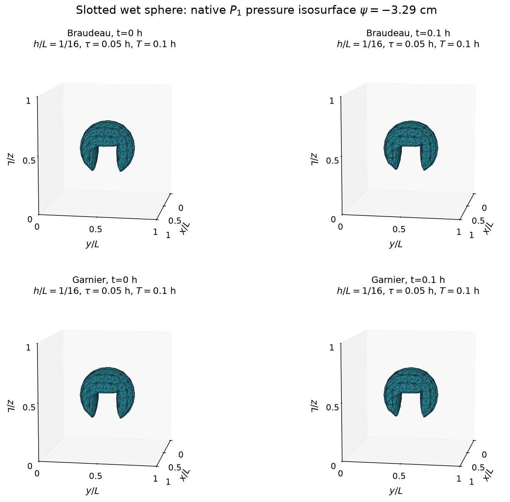

# Braudeau–Richards finite element examples

Small 2D and 3D examples for the numerical study of water flow in deformable porous media. Compare the implicit and semi-implicit schemes, inspect Newton convergence, and view the computed pressure fields.

[](https://colab.research.google.com/github/moalhadiri/BraudeauRichardsFEM-article/blob/main/run_examples.ipynb#scrollTo=parameters)

**[Choose parameters and run](https://colab.research.google.com/github/moalhadiri/BraudeauRichardsFEM-article/blob/main/run_examples.ipynb#scrollTo=parameters)**

## Run in your browser

1. Click **Choose parameters and run** above. Sign in with Google if prompted.
2. Choose the common 2D and 3D meshes, final time T and time-step indices ℓ. All examples follow these settings automatically.
3. Choose **Runtime → Run all**, then inspect the console results and figures. The numerical output is also saved as `results.txt`.

The form updates the calculations, figures and session README automatically. Spatial studies use three meshes ending at the selected size; the sphere and Fourier examples use the 3D mesh and smallest selected time step. Dry infiltration uses the 2D spacing and keeps its adaptive time steps. Select `use_separate_settings` only when you want different settings for individual examples. The public GitHub README changes when the repository owner publishes new results.

Use a standard CPU runtime; no paid subscription is required. Free runtime availability depends on Colab. See the [Colab FAQ](https://research.google.com/colaboratory/faq.html) for details.

For repeatable results, the notebook uses the checked source revision shown in its setup cell.

<!-- BEGINEXAMPLERESULTS -->
## Computed results

**26 calculations completed · 115/115 checks passed.** Newton stopping tolerance: `1e-8`.

Last successful run: **2026-10-24T20:35:40+00:00**. Source revision: `5f0126301222`. Parameter fingerprint: `aae8b7d4ae62`.

Temporal validation: **T = 1**, **h = 1/9** in 2D and **h = 1/9** in 3D; time-step indices **ℓ = 1, 2, 3**.

<p align="center">
  
</p>

*Native P1 pressure isosurfaces at ψ = −3.29 cm, computed on the tetrahedral mesh at t = 0 and t = T, at true geometric scale. Braudeau: h/L = 1/16, τ = 0.05 h, T = 0.1 h, nx = 17; Garnier: h/L = 1/16, τ = 0.05 h, T = 0.1 h, nx = 17.*

The table shows the finest spatial grid and smallest time step of each validation group. H¹ is the full norm.

| Study | Scheme | h | ℓ | τ | L² error | H¹ error | Newton max |
| --- | --- | --- | --- | --- | --- | --- | --- |
| 2D spatial | Implicit | 1/16 | 3 | 1/40 | 5.823523e-4 | 1.763395e-2 | 3 |
| 2D spatial | Semi-implicit | 1/16 | 3 | 1/40 | 5.823523e-4 | 1.763395e-2 | 3 |
| 2D temporal | Implicit | 1/9 | 3 | 1/40 | 6.353148e-4 | 1.145151e-2 | 3 |
| 2D temporal | Semi-implicit | 1/9 | 3 | 1/40 | 4.320047e-4 | 1.146767e-2 | 3 |
| 3D spatial | Implicit | 1/8 | 3 | 1/40 | 2.849712e-4 | 4.373427e-3 | 3 |
| 3D spatial | Semi-implicit | 1/8 | 3 | 1/40 | 2.849712e-4 | 4.373427e-3 | 3 |
| 3D temporal | Implicit | 1/9 | 3 | 1/40 | 8.504627e-5 | 1.436968e-3 | 3 |
| 3D temporal | Semi-implicit | 1/9 | 3 | 1/40 | 7.703710e-5 | 1.425998e-3 | 3 |

[All 26 cases: JSON](data/latest_results.json) · [CSV](data/latest_results.csv)

To refresh these values locally, run `python test.py --no-show --update-readme`, then commit and push the generated README, image and data files. Visitor runs in Colab keep their results in their own session and do not publish to this repository.
<!-- ENDEXAMPLERESULTS -->

## What the test covers

The selected meshes, final times and time-step indices determine the calculations and checks in each run. The test prints errors, Newton iteration counts, correction norms and linear residuals.

| Test | Settings |
| --- | --- |
| Spatial validation | Stationary polynomial reference in 2D and 3D; implicit and semi-implicit schemes. |
| Temporal validation | Both schemes in 2D and 3D; meshes, final time T and time-step indices ℓ are selected in the form. |
| Nonlinear Fourier example | 3D validation with constitutive exponent ℓₚ = 3. |
| Physical examples | Wet slotted sphere with the Braudeau and Garnier parameters; dry infiltration in 2D. |

These small grids provide a quick implementation check. The article also reports finer meshes and longer physical runs. Temporal references are `exp(-t^3)*P` in 2D and `exp(-t)*P` in 3D; `H1` denotes the full norm.

A mesh value n means n subdivisions, so h = 1/n on the unit validation domains, with n + 1 nodes per direction. Time steps follow **τ = 0.1 × 2^(1 − ℓ)**: ℓ = 1, 2, 3, 4 gives τ = 0.1, 0.05, 0.025, 0.0125. This time-step index ℓ is separate from the Fourier constitutive exponent **ℓₚ = 3**. Final times for fixed-step cases must be multiples of their time steps.

## Run locally

From the repository folder:

```sh
python -m pip install -r requirements.txt
python test.py
```

Use `python test.py --no-show` to save the figures without opening windows. Add `--workers 2` for two assembly workers. Authors maintaining the local examples can change the saved defaults in [parameters.json](parameters.json); the Colab form supplies these settings directly for browser runs.

`test.py` runs the examples; `source/` contains the meshes, element routines, models, assembly and solvers. `data/` contains the published spatial errors and the numerical source provenance. Generated figures and text are saved in `results/`.

## Citation

Please cite the accompanying article when using these examples. The authors and article title are listed in [CITATION.cff](CITATION.cff).
